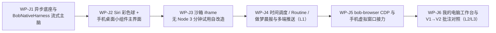

# Bob — Development Route

> 长期阶段与退出门（Exit Gate）。当前基线与活跃施工项唯一见 [CURRENT_STAGE](CURRENT_STAGE.md)。阶段编号 `BP#` 不复用前身项目的 Phase 编号；里程碑不代表工期承诺，实测证据与回退贯穿每个阶段。

## 阶段总览（`BP0` → `BP7`）

| 阶段 | 目标 | 核心退出门（Exit Gate） | 当前状态 |
|---|---|---|---|
| **BP0 真相与保护** | 盘点前身项目并固定备份 | 旧仓库 refs、未提交改动与 worktree 均有校验副本，列出 `unknown` | **已完成** |
| **BP1 架构定案** | 确定单内核语义、所有权、连接与威胁模型 | `BOB-D-005` / `D-006`、实体对齐与 `WP-03` 威胁模型通过审阅 | **已完成** |
| **BP2 骨架与契约** | `bob-kernel` / `bob-transport` / Tauri 壳与契约测试 | 桌面/Android 骨架、Schema 一致性与外置编译隔离就位 | **已完成** |
| **BP3 个人环境 MVP** | 任一实例独立 BYOK 对话/捕获 + 手机与 PC 接续 | F1、F2、F3、F4 本地闭环与核心断线/重复防线验证；部分真机终验持续推进 | **核心上线，真机收尾** |
| **BP4 Work 与 Harness** | 事项晋升 Work；项目胶囊 + 多 Harness 接入 + 跨节点互借与多参谋长总线 | F5/F6、`BOB-D-010/013/017`：胶囊注入、多工具发现/续聊/取消/策略隔离与主权审批闭环 | **主力已上线，长尾矩阵收尾** |
| **BP5 迁移与旧系统退役** | 旧 App `0.9.x` 与旧 Online 数据迁移、旧入口逐项退役 | 迁移可读回可回退、旧版只读可查、获用户退役确认 | **仅只读导入，待退役确认** |
| **BP6 开源通用化** | 第三方可安装、配置并安全升级 | `LICENSE` 与依赖审计、彻底去个人化（`BOB-D-007`）、默认连接、安装器与升级保留数据 | **规划中（`WP-E3` 前置对齐）** |
| **BP7 iOS 与扩展** | iOS 形态稳定化与扩展协议第二实现 | 主屏幕 PWA + APNs 推送稳定，按真实需求评估原生包与窄接口第二实现 | **PWA 路线已立，按需推进** |

---

## `S0` → `S4` 与过渡期整合基线

- **核心底座已收敛（2026-10-31 首版上线，见 [S0–S4 验证报告](evidence/2026-10-31-s0-s4-bob-online-verification.md)）**：完成凭据脱敏与先验后合并（`S0`）、原位升级 Work 与退避轮询（`S1`）、Online 兼容续聊与审阅（`S2`）、`bob-runtime` / `bob-node` 单一内核托管同一 Vue 3 前端（`S3/S4`）。
- **不变的整合原则**：旧 App 的个人助理与旧 Online 的开发治理合入同一纯 Rust 内核；过渡期只读导入旧平台记录，严禁双写。独立原型实验室 `bob-bot` 按 `BOB-D-015` 保持分库独立演进，仅迁移已验证成熟的产品模式。

---

## `BOB-D-015` 统一收敛里程碑：`WP-J1` → `WP-J6`（已交付底座）

依据 [DECISIONS](DECISIONS.md) `BOB-D-015`，评价优先面向不同层级的完整使用闭环，已交付 6 个垂直工作包：

| 工作包 | 层级目标与交付内容 | 状态与依据 |
|---|---|---|
| **WP-J1** | `bob-node` 升级 `tokio + axum`；纯 Rust `BobNativeHarness` + `Bob Tool Bus` + `$10`/月花费上限 | **代码与门禁已交付**（[验证回执](evidence/2026-11-11-wp-j1-j6-jarvis-convergence-verification.md)） |
| **WP-J2** | Jarvis 单一交流窗口：流体水滴 `<JarvisOrb />` + `<JarvisWidgetGrid />` + L1/L2/L3 渐进降噪 | **代码与线上已交付**；手机端真机验收待合流复核 |
| **WP-J3** | 无凭据 `<iframe sandbox>` 小组件 + 持久化 3 分钟试用（保留/撤销与 5 版自动回退） | **代码与门禁已交付**；真模型体验打磨并入 `WP-E1.4` |
| **WP-J4** | 统一时间对象、Routine 试运行与 `Draft`、五阶段做梦 + 晨报 + 四档主动关心、Web Push / Android / 微信桥 | **代码与门禁已交付**；真实终端推送与日常连续验收持续跟踪 |
| **WP-J5** | `bob-browser` crate（CDP 无障碍树 + iframe/Shadow DOM）+ `<VirtualBrowserModal />` 接管 | **本地 CDP 通过**；常驻节点 3～5 办公站点 390px 接管并入 `WP-E1.1` |
| **WP-J6** | 桌面端挂载同源主脑与授权目录 Tool、`V1→V2` 批注对照修改、单 VPS 部署脚本 | **代码与门禁已交付**；多端端到端实景闭环持续演进 |

---

## `BOB-D-017` 远程优先与可插拔多参谋长总线：`WP-C1`（2026-11-16）

依据 [DECISIONS](DECISIONS.md) `BOB-D-017`：
- **去 `X1C` 单点依赖（Peer-Terminal Model）**：各常驻与桌面设备平等挂载 `~/work/common/`（Syncthing SSOT，含 `project_registry.yaml` 与 `chief_briefing.py`）与独立 `~/work/code/*` Git 仓库；
- **多参谋长平权协作与零锁定退订**：`bob-online` 主助理、外部 `grok_bot` / `meta_muse` 等无状态参谋长通过 `/api/bot/v1/mcp` 共用 `bob_briefing` → `bob_order_submit` → `bob-online` 唯一主权审批卡（`pending_approval`） → `bob_orders` 回执流转；撤销任一外部席位 `revoked: true` 即刻下线，历史指令与成果回执零丢失。

---

## `BOB-D-016` 系统性进化路线：`WP-E1` → `WP-E4`（当前主航道）

在已交付底座之上，按以下 4 个波次推动“白领日常丝滑可用、三路径 90 秒开箱、开放零 Node 扩展生态”：

| 阶段工作包 | 核心目标 | 退出门（Exit Gate） |
|---|---|---|
| **WP-E1 实景闭环、快慢双模、开箱与记忆连续性** | 本地已交付：`Resident Clerk + Async Worker`、`OnboardingWizard`、UTC+8 ISO 日期守卫、`WP-E1-M` 长期记忆/阶段摘要/历史召回/逐问题覆盖、`project_registry.yaml` SSOT 与 `/opt` 后台隔离。剩余线上门禁：常驻节点 Chromium 390px 真实办公站点接管、`WP-E1.4` 商业 LLM 小组件试用调优与 Android 真机终验 | 至少 3 个真实办公站点接管+Cookie 重启保活+Routine 复跑实测通过；主助理连续性与长期记忆在桌面/手机端获得用户视觉与真机终验 |
| **WP-E2 白领办公文档深度处理与高频 IM 触达** | `BobNativeHarness` 内置纯 Rust 解析与生成 **`.pdf` / `.xlsx` / `.docx` / `.csv`** 并直通 `V1→V2` 批注审阅；落地标准化 `ChannelAdapter`（飞书 / Telegram / 微信桥增强） | 任意办公文件解析与格式化产出可下载、可批注产出 V2；IM 触发任务与 `Draft`/接管链接闭环通过 |
| **WP-E3 零门槛三路径部署与桌面扫码直连** | CI 发布含 Chromium 与 `fonts-noto-cjk` 的多架构预编译镜像与静态二进制；90 秒一键交互引导脚本与 1Panel/CasaOS/NAS 模板；桌面托盘首次 3 步向导与手机扫码直连 | 空白轻量服务器 90 秒零编译启动 HTTPS 节点；Windows 桌面端零配置文件完成 Key + 授权目录 + 手机扫码 |
| **WP-E4 MCP 连接器客户端与 QuickJS 插件体系** | 纯 Rust MCP Streamable HTTP 客户端 + OAuth 2.1 令牌保险箱（写操作默认 `SideEffect`）；内嵌 `rquickjs`（16MB/500ms）执行 `.bobpkg` 微应用，界面统一为「能力目录」 | 成功连接至少 2 个外部 OAuth/HTTPS MCP 服务；`rquickjs` 小组件运行稳定且超时/错误 3 分钟自动回退；全程零外部 Node.js 依赖 |

---

## 长尾退出门约束摘要（`BP4` / 外部工具 / 收集箱）

- **单设备多 Harness 入口（`BP4-06/07`）**：设备身份与多访问路径（公网 / Tailscale）分离探测，遵循 [BOB-D-013](DECISIONS.md) 原生持久接口优先策略；工具启停策略与历史只读严格分离，未收到节点回执不标全部停用。
- **单一收集箱与每日分拣（`BOB-D-014`）**：`Capture -> Inbox -> Daily Review Card` 确认后才落盘项目 `todo.md` / 日程 / 笔记，离线 PC 工作区诚实展示 `Waiting for PC`。
- **完整日常历史变更记录**：2026-10-31 至 2026-11-15 细粒度阶段演进已归档至 [历史阶段归档](evidence/2026-11-17-historical-stage-archive-oct31-nov15.md)，用户可见版本变更见 [CHANGELOG](CHANGELOG.md)。
