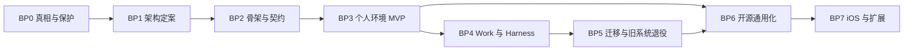

# Bob — Development Route

> 长期阶段与退出门（Exit Gate）。当前施工只看 [CURRENT_STAGE](CURRENT_STAGE.md)。阶段编号 `BP#` 不复用前身项目的 Phase 编号。步骤不代表工期承诺，测试与回退贯穿每个阶段。

## 阶段总览

| 阶段 | 目标 | 退出门 | 对应来源提案步骤 |
|---|---|---|---|
| **BP0 真相与保护** | 知道前身项目有什么、谁在写、哪些能恢复；资产先保护起来 | 旧仓库的 refs、未提交改动、搬移的 worktree 都有经过验证的保护副本；盘点有时间戳并列出 unknown | A0、A、B |
| **BP1 架构定案** | 内核拓扑、数据所有权、连接方案、威胁模型、组件去留 | BOB-D-005、BOB-D-006 被接受；同名实体语义对齐表完成；威胁模型通过审阅；组件去留表获批 | C、D、E |
| **BP2 骨架与契约** | 新仓库可以构建；内核 crate、Tauri 外壳、版本化契约、测试框架就位 | 桌面和 Android 能启动空壳；契约有 schema 和一致性测试；缓存隔离合规；CI 能跑 | F 的前置 |
| **BP3 个人环境 MVP** | 任一单实例可独立对话与捕获；再验证手机与PC协作、事项连续 | F1、F2、F4 的验收在作者的真实设备上通过（真机、公网分别记录）；断线与重复发送场景通过 | F |
| **BP4 Work 与 Harness** | 事项晋升为 Work；项目画像胶囊（防跑偏）+ 快慢双轨调度（内置 API 原生 Subagent + 低频任务卡/持久会话接入 DSH/AGY/Codex）；跨节点能力互借（海外模型代理 + `bobbik-pc` 独显/显示器渲染验证节点 + 常开节点） | F5、F6 及 BOB-D-010 验收；项目画像胶囊自动注入任务卡；原生 Subagent 与跨节点能力借用（含渲染截图回传 V1/V2）有实测证据；同一事项跨 Harness 续接 | G、H（部分）、BOB-D-010 |
| **BP5 迁移与旧系统退役** | 旧 App 0.9.x 和旧 Online 的数据与用户迁入；旧路径逐项退役 | 数据迁移可以读回、可以回退；旧版本只读可查；退役有用户确认 | G |
| **BP6 开源通用化** | 别人能装、能用、能升级 | LICENSE 与依赖许可证审计；去个人化；默认连接 L1+L2+L4；安装器；升级保留数据；安全报告渠道 | I、J |
| **BP7 iOS 与扩展** | iOS 评估；第二种实现验证窄 Provider 契约 | 由届时的真实需求决定 | I |

## 当前位置与分阶段状态（2026-10-31）

2026-10-31 代码/证据核对：已完成 **S0 → S1 → S2 → S3/S4 核心闭环**，并在 Hostinger VPS2 (`187.124.144.87`) 部署上线 **`https://bob-online.bobbik.org`** 常开节点与统一网页端（只读幂等导入旧 Online 69 个项目）。当前事实及逐项验证记录见 [CURRENT_STAGE](CURRENT_STAGE.md) 与 [验证报告](evidence/2026-10-31-s0-s4-bob-online-verification.md)。

| 阶段 | 用户得到什么 | 当前状态与依据 |
|---|---|---|
| S0：RV-05/06/08/09、RV-13、OL-02/04 | 保存/连接/同步的反馈可信，凭据和权限边界明确 | **已完成代码与测试验证**：共享配置剔除明文凭据，PeerSync 先校验后合并并重算 SHA-256，固定快照严格断言 |
| S1：RV-11–13、16–18、20 / BP3 | 不配服务器也能直接对话；个人事务能在手机和 PC 接续 | **内核与 UI 闭环完成**：原位会话升级 Work（`RV-17`）、轮询/同步指数退避（`RV-18`）、结构化决定（`RV-16`）、本地指标（`RV-20`）；待补 `RV-11` 真机商业 Key 实测 |
| S2 / M0：OL-01–07 | App 看见云端原项目，然后在同一任务继续工作 | **已完成并经公网验证**：配对、兑换、项目/任务/快照读取、幂等 `operations`（续聊、V1→V2 修订、人工审阅）与凭据吊销均通过 `https://bob-online.bobbik.org` 实测 |
| S3 / M1：XP-01–03/05 | 同一业务逻辑可脱离 Tauri，现有手机/PC 不退化 | **已完成 `crates/bob-runtime`**：抽离 `SecretStore`、`RuntimeCapabilityManifest`、`ModelHubRuntime`，根 Workspace 统一管理 `bob-kernel`、`bob-transport`、`bob-runtime`、`bob-node` |
| S4 / M2–M4：XP-04、XP-06–10 | 常开节点运行同一 Rust 内核，浏览器与 App 共用同一界面 | **已部署上线 `https://bob-online.bobbik.org`**：`bob-node` 托管统一 Vue 3 前端，Caddy `common_auth` 保护浏览器入口，只读幂等导入旧 Online 69 个项目 |

## 不变的整合目标

旧 App 的个人助理与旧 Online 的开发治理进入同一 Rust 内核；`bob-online.bobbik.org` 与旧 `agent.bobbik.org` 在过渡期并行运行，旧数据库只读导入、不双写。BP4/F6 跨节点规则见 [kernel-schema](wiki/kernel-schema.md)，能力继承见 [COMPONENT_MAP](COMPONENT_MAP.md) §6。

## BP4依赖与分段退出门（按BOB-D-011）

顺序：BP3/F1默认助理持久对话与实际发送 → BP4-06唯一目标关联/派发/结果回流（并行保留F2/F5原会话接续）→ BP4/F6共享对象归属与离线边界 → BP4-04最小上下文索引 → BP4-06单执行者V1/V2 → BP4-07能力借用 → BP4-05有界子代理。依据BOB-D-012，不要求先迁移全局Home；涉及现存共享对象迁移仍单独审阅。

最小增量退出门是手机原会话可持续使用与单执行者成果闭环；不等待完整子代理池才交付。BP4整阶段退出仍需F5/F6适用能力的证据，未验项保留，不因最小增量发布自动完成整个BP4。施工步骤、失败处理和权限只在CURRENT_STAGE §3维护。

默认助理入口增量沿BP3/F1与BP4-04/06推进：在保留原生直达的基础上，先实现持续主对话、意图/唯一目标关联及明确歧义提示，再接现有单执行者与结果引用回流，最后验证指定父版续改。专职角色与多节点自动选型在最小闭环之后；不另立路线，不越过对象owner与授权边界。

BP4 / F2/F5阅读增量：四项底栏、可持久化沉浸和DSH当前文件只读预览已完成网页发布，证据见CURRENT_STAGE。下一步仍沿3.3/3.6补Tauri手机预览/分页、DSH工具记录传输优化、结构化成果清单与ArtifactVersion快照，不新设并行计划；本轮不恢复B4。

网页权威游标分页与固定输入区已发布 dsh-paging-20261031-r1，证据及范围见 CURRENT_STAGE；不等于手机原生或完整历史附件验收。
