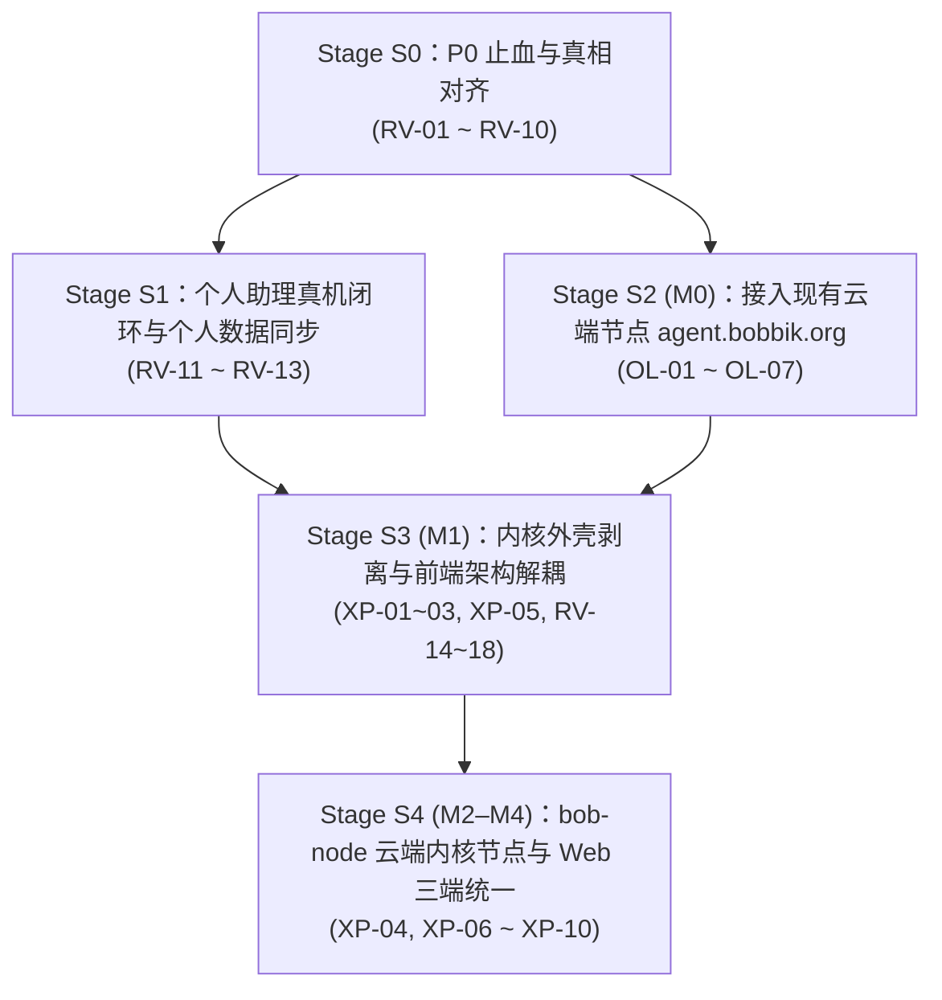

# Bob — Development Route

> 长期阶段与退出门（Exit Gate）。当前施工只看 [CURRENT_STAGE](CURRENT_STAGE.md)。阶段编号 `BP#` 不复用前身项目的 Phase 编号。步骤不代表工期承诺，测试与回退贯穿每个阶段。

## 阶段总览

| 阶段 | 目标 | 退出门 | 对应来源提案步骤 |
|---|---|---|---|
| **BP0 真相与保护** | 知道前身项目有什么、谁在写、哪些能恢复；资产先保护起来 | 旧仓库的 refs、未提交改动、搬移的 worktree 都有经过验证的保护副本；盘点有时间戳并列出 unknown | A0、A、B |
| **BP1 架构定案** | 内核拓扑、数据所有权、连接方案、威胁模型、组件去留 | BOB-D-005、BOB-D-006 被接受；同名实体语义对齐表完成；威胁模型通过审阅；组件去留表获批 | C、D、E |
| **BP2 骨架与契约** | 新仓库可以构建；内核 crate、Tauri 外壳、版本化契约、测试框架就位 | 桌面和 Android 能启动空壳；契约有 schema 和一致性测试；缓存隔离合规；CI 能跑 | F 的前置 |
| **BP3 个人环境 MVP** | 作者每天能用：PC 和手机上对话与捕获，事项连续，手机让 PC 处理文件 | F1、F2、F4 的验收在作者的真实设备上通过（真机、公网分别记录）；断线与重复发送场景通过 | F |
| **BP4 Work 与 Harness** | 事项晋升为 Work；Execution 和成果版本；接入 DSH、AGY、Codex；常开节点 | F5、F6 验收；每个 Harness 的能力矩阵有证据；同一事项跨 Harness 续接 | G、H（部分） |
| **BP5 迁移与旧系统退役** | 旧 App 0.9.x 和旧 Online 的数据与用户迁入；旧路径逐项退役 | 数据迁移可以读回、可以回退；旧版本只读可查；退役有用户确认 | G |
| **BP6 开源通用化** | 别人能装、能用、能升级 | LICENSE 与依赖许可证审计；去个人化；默认连接 L1+L2+L4；安装器；升级保留数据；安全报告渠道 | I、J |
| **BP7 iOS 与扩展** | iOS 评估；第二种实现验证窄 Provider 契约 | 由届时的真实需求决定 | I |

## 依赖说明与 2026-10-30 审查重排计划

### 产品完整性约束（2026-10-30 核对更新）

BP3 退出门包含 F1 的独立 BYOK 助理，配对 Home 和远端 CLI 链路通过不能替代它。
- **F1 当前真实状态（部分完成）**：已完成 `0006.sql`、`direct_provider.rs`、`direct_llm.rs`、系统安全存储凭据（Windows DPAPI / Android Keystore）、三协议适配与 Loopback HTTP 测试，以及已配对 Replica 在 Home 离线时直接调用模型的重连幂等汇合规则（`replica_direct_sync_outbox` + `HomeRequest::ReplicaDirectTurn`）；**尚未完成**真实外部 Key 的真机问答验收（RV-11）、会话历史检索与多模态附件（RV-21）。
- **F3 当前真实状态（部分完成）**：已在 `personal_ops.rs` 落地基础表与状态操作（`create_capture`、`propose_memory`/`update_memory_state`、`upsert_note`、`create_schedule_item`/`update_schedule_status`、`record_decision`），前端已拆出日程/工作/知识主视图；但存在**前端↔内核字段与状态值错位**（RV-01~07）、**缺少个人数据 Replica→Home 同步路径**（RV-13）以及**决定记录缺少 IPC/UI**（RV-16），修复并真机验证后才算达成 F3。
- **三端统一与云端节点（`agent.bobbik.org`）真实状态**：Android 手机与 Windows 电脑已共用同一套 Vue 前端与 Rust 内核（约 80%）；云端 `agent.bobbik.org` 当前运行的是旧 Online（`cloud-agent` Node/TS），已具备 `/api/client/v1` 只读客户端接口（`bob-core-client/1.0`），但新 App 尚未实现 HTTP 客户端接入（近期轨道 OL-01~07）；让云端节点也运行同一 Rust 内核（`bob-node`）并让浏览器复用同一前端属于长期轨道（XP-01~10）。

### 近期至中期五阶段施工路线（Stage S0 → S4）

详细任务卡与验收路径见 [CURRENT_STAGE](CURRENT_STAGE.md) 与根目录 `todo.md`：

| 施工阶段 | 核心目标 | 包含任务编号 | 对应大阶段 | 退出门（Exit Gate） |
|---|---|---|---|---|
| **Stage S0：P0 止血与真相对齐** | 修复已安装手机版本中日程/记忆/工作间的契约错位与静默吞错；建立 Rust↔UI JSON 快照契约测试；修正文档超范围陈述 | `RV-01` ~ `RV-10` | BP3 修正 | Rust 快照契约测试、Node、Playwright 全绿；Pixel 8 实测新建日程/待办→勾选完成→杀进程重开仍保持；文档无虚假函数名或矛盾状态 |
| **Stage S1：个人助理真机闭环与数据同步** | 用真实 API Key 完成 Pixel 8 与 Windows 的 F1 真机验收；清理/禁用虚假可点控件；打通笔记/日程/捕获/记忆的 Replica→Home 同步 | `RV-11` ~ `RV-13` | BP3 核心 | 真机 F1 问答与断网保存 Evidence 归档；所有可点控件均有真实效果；手机离线新建笔记/日程在电脑上线后幂等汇入 Home |
| **Stage S2 (M0)：接入云端节点 `agent.bobbik.org`** | 先复用云端现有 `/api/client/v1`（`bob-core-client/1.0`）完成配对与项目/任务/消息只读接入；随后在 `cloud-agent` 补齐幂等写入并接通 App 受控续聊 | `OL-01` ~ `OL-07` | BP3-02 | App 设置页可配对/吊销云端凭据；侧栏与工作视图可离线查看云端项目缓存；补齐写入后专用测试项目两轮续聊与断网对账通过 |
| **Stage S3 (M1)：内核外壳剥离与前端解耦** | 抽出平台能力 Trait（`bob-runtime`），把 160KB 业务逻辑从 `src-tauri` 下沉；原生 HTTPS 替换 `curl`；拆分 2842 行 `App.vue`、补桌面左侧栏、决定记录 UI、对话升级 Work 与轮询退避 | `XP-01`~`03`, `XP-05`, `RV-14`~`18` | BP3 → BP4 | `src-tauri` 仅留薄命令壳；`cargo test --workspace` 在 Windows + Linux CI 全绿；`App.vue` < 600 行；桌面横屏左导航与移动底导航自适应 |
| **Stage S4 (M2–M4)：`bob-node` 云端节点与三端统一** | 补齐 Linux/macOS 密钥与进程沙箱；交付无界面 `bob-node` 服务端程序与 HTTPS/SSE Web 适配层；浏览器直接运行同一套 Vue 前端；逐步收敛旧 Online | `XP-04`, `XP-06` ~ `XP-10` | BP4 → BP5 → BP6 | Linux 容器/VPS 启动 `bob-node`，手机/电脑/浏览器三端共用同一套前后端代码完成对话与任务流转；旧 Online 能力按裁决表逐项迁移或退役 |

### BP4/F6：跨节点持续开发的渐进门槛

在 BP3 多会话与来源索引中已预留 Project→多个 Workspace、按设备/任务分组及可用性投影，并已在 `workspace_handoff.rs` 完成副本只读盘点（BP4-01）、显式交接与 `fencing_token` 原子递增（BP4-02）及 5 大故障场景内核测试（BP4-03）。源码提交、push、敏感素材同步、节点配置和 Home 迁移均按具体操作授权，计划归并不执行这些动作。详细验收与状态见 [CURRENT_STAGE](CURRENT_STAGE.md)；交接规则只在 [kernel-schema](wiki/kernel-schema.md) 维护。

## 来源

- `references/historical-plans/2026-10-28_BOB_UNIFIED_DEVELOPMENT_PLAN_PROPOSED.md`（用户提出的统一构想，A–J 步骤）
- `references/historical-plans/2026-10-28_unification_review.md`（遗漏审查与选项）
- 2026-10-30 愿景/功能/架构与三端统一审查结论（归档于 `todo.md` `RV-01~21`、`OL-01~07`、`XP-01~10`）
