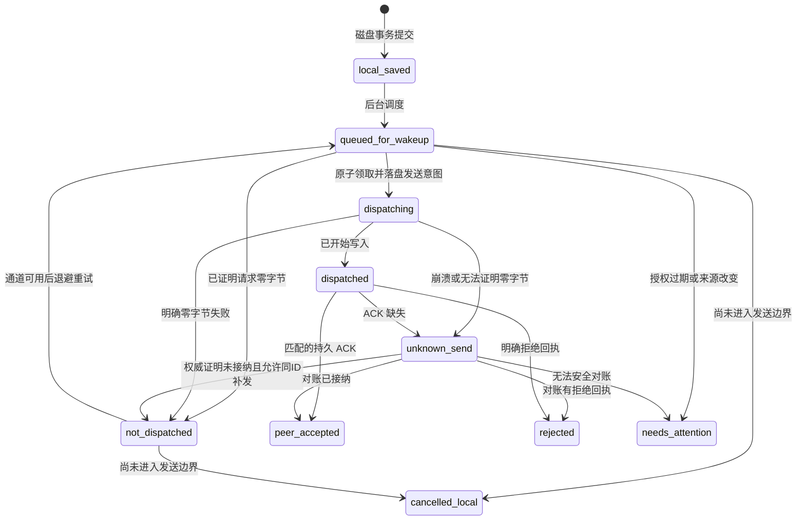

# bob-kernel：统一 Schema 与可靠发送契约

> WP-02，2026-10-28。依据 BOB-D-004/005/008 与 [WP-01 盘点](../evidence/2026-10-28-wp01-deep-inventory.md)。这是可检验的 **设计草案**，不是数据库迁移或已实现能力。只有本页维护详细 Schema；Architecture 保留边界，CURRENT_STAGE 保留施工顺序。WP-03 的安全定案及 BP2 授权仍独立。

## 1 语义合并与迁移边界

| 旧对象 | 统一对象 / 规则 |
|---|---|
| App Conversation / Message、Online Session / Message | `conversations` / `messages`；逻辑会话与 Harness 原生会话分开；来源 ID 通过 `legacy_refs` 保存，不以标题匹配 |
| App Goal / Milestone / Task (`work_objects`)，另有 `goal_*` 运行表 | `goals` → `milestones` → `tasks`；目标是分组，Task 是唯一用户事项；运行尝试归 Execution。不能把历史每个 goal_step 自动转换成已接受 Task |
| Online Project、App work_projects | `projects`；Workspace 是设备上的受控目录引用，不把项目 ID 当目录 |
| App Decision | `decisions`；保留依据、备选、状态与替代关系，助手建议不自动 accepted |
| App Artifact 对象、Online 带版本 Artifact | `artifacts` 是逻辑成果，`artifact_versions` 是不可变快照；旧记录没有快照则保留来源与 missing 状态，不能伪造 hash |
| App Evidence / 原始捕获 | `captures`、`evidence`、`evidence_links`；证据可引用原始消息/文件，但不等于检查通过 |
| Online Execution / Verification / Review | `executions`、`verification_runs/checks`、`reviews`；生成结束、检查通过、人审接受分别记录 |
| App Memory / 笔记 / 日程 | `memories` 保留来源与纠正；笔记和日程保留个人事务域扩展，BP2 不顺带迁移全部旧表 |
| App rpc_staged_outbox / peer_revocation_outbox / write_mobile_outbox | 分别是接收端配置暂存、吊销队列、JSON 写入命令，**都不是**统一发送端 `intent_outbox`；只复用相关测试思路 |

迁入前另有文件级批准：来源 commit + 工作树文件 hash、许可证、允许文件、迁移映射、读回和回退。此页不授权复制旧代码或打开生产数据库。统一项目新建独立数据库；不对旧 `bob.db` 或 Online DB 原位执行以下 DDL。

## 2 存储约定

- 单用户、一个 Home 权威。作者的 Home 由配置指定为 X1C；Schema 不硬编码设备名、IP、目录或供应商。
- 每台设备独立 SQLite。正式实现启用外键、WAL、`synchronous=FULL` 并检查 COMMIT 结果；本轮只在临时内存数据库校验 DDL。真实落盘/断电可靠性留给 BP2 测试。
- 两跳路由明确：Replica 的 `target_device_id` 是当前 Home；执行设备/原生会话绑定冻结在载荷中。Home ACK 后由 `runner_dispatches` 向执行设备派发。纯历史读取可经只读适配器直连，产生副作用的续聊必须经过 Home 接纳。Home 不可达时不偷偷直连 Harness 绕过治理；本机 BYOK 对话/捕获只生成本地追加记录，不修改 Home Task。
- ID 是客户端预生成的不透明全局 ID。时间为 UTC 毫秒；排序与冲突判断用 Home 序号/版本，不能依赖设备时钟。
- `version` 由 Home 事务递增。Replica 缓存不能直接改权威表；本地暂存消息有 `acceptance=local`，待 ACK 后升级，不能冒充权威写入。
- 密钥只存 vault 引用；Outbox 的 payload 不带 Token、SSH 私钥或模型 Key。凭据不可用可以排队，失效需展示需要授权，不自动扩大权限。
- JSON 字段承载版本化载荷，不免除 Rust 的类型、大小、引用归属及权限校验。以下 DDL 的关系约束与第 4 节事务共同构成合同，不能只实现 DDL。

## 3 SQLite DDL 草案（新库，单一连续 SQL 块）

### 项目、设备副本与跨节点交接合同（2026-10-30，设计待实现）

本节解释并细化既有 Project ≠ Workspace ≠ Host 和 Task > Execution，不引入第二套任务系统。来源为用户关于设备/任务分组、设备离线、VPS持续工作及GitHub同步的疑问。以下是实施合同与建议默认行为，不表示已经实现自动交接，也不表示用户决定迁移Home。

#### 身份与责任

| 对象 | 稳定含义 | 不能据此推断 |
|---|---|---|
| Project | 用户持续推进的一件项目；可关联多个仓库、设备工作区和对话 | 同名目录或同一个Git远端就一定是同一项目 |
| Conversation / Task | 对话保存交流；Task保存要完成的事项，执行绑定来源对话 | 换设备/工具必须新建项目或丢掉旧对话 |
| Workspace | 某设备上的受控目录及权限范围；项目可绑定多个副本 | 有相同文件名就具有相同内容、依赖或权限 |
| Repository / GitHub | 源码版本的交换来源；仓库、分支、commit是可核对的基线 | 自动包含未提交修改、未push提交、未跟踪文件、LFS内容、子模块、被忽略素材、凭据或原生会话 |
| Execution | 在指定设备/工作区/Harness/输入版本上的一次尝试 | 切换执行者能继续旧进程；新执行等于用户已接受成果 |
| Home / 执行节点 / 客户端 | 分别负责权威接纳、实际工作和用户入口 | VPS在线就意味着Home、仓库、模型登录及执行条件全部可用 |

同一逻辑项目在PC和VPS各有一份检出目录，通常应关联同一project_id、不同workspace_id；关联必须显式记录来源，不能仅凭远端URL或标题自动合并。Fork、实验分支可属于同项目的候选工作，也可由用户另立项目，保留关系。Git同步不迁移原生会话、批准或设备权限；跨工具继续通过任务状态和受控上下文包，不要求复制整个聊天数据库。

#### 分开记录三个维度

1. **资源可用性**：设备最近观测、连接/认证、Home可达、执行器可用、工作区权限、依赖/素材可用。保存观测时间；超出有效期为待核对，不能沿用历史绿点。持续性由健康检查证明，不按“VPS”标签直接判定。
2. **副本一致性**：最后可验证commit/分支、工作树修改/未跟踪文件摘要、远端可读基线、素材与依赖清单及检查时刻。未观察到关机前状态就是未知，不能把上一次clean当作关机前已同步。
3. **工作状态**：Task/Execution原状态独立保留；节点失联不自动completed/failed，不自动释放写入租约或重派。可查看、可留言排队和可立即执行是不同能力。

界面能力由这三个维度推导，不能把它们压成一个“在线”布尔值。已登记且已缓存的历史和成果允许离线查看；未缓存文件必须显示不可用，不声称已完整同步。

#### 换节点前的决策表

| 情况 | 默认行为 | 继续条件 |
|---|---|---|
| 文件仍在在线原设备、运行条件满足 | 在原工作区继续，不因更便宜模型擅自搬家 | 当前授权和写入归属可核对 |
| 原设备离线，但曾完成可核验交接，目标副本精确匹配且旧写入已封存 | 同Task创建新Execution | Home/权限/租约以及目标能力检查均通过 |
| 仅知道GitHub存在仓库，原设备可能有未同步修改 | 标为“版本待核对”，保留历史和留言，不自动接管 | 原设备恢复核对，或用户明确选择基于指定旧commit另开隔离候选 |
| 已知原设备有未提交或未push内容，且无交接快照 | 标为“最新工作仅在原设备”，等待 | 恢复设备并交接；不能从GitHub恢复不存在于远端的内容 |
| 目标分支落后、分叉或已有本地修改 | 展示差异，保护双方；不自动reset、覆盖或强推 | 经核对的隔离工作区/合并策略与权限 |
| 有源码但缺少大素材、LFS对象、子模块或运行依赖 | 显示具体缺项，不标“可继续” | 必需材料/版本校验和依赖检查完成；不默认安装软件 |
| 原执行还在运行或终止未知 | 保持原租约/unknown，查询原回执 | 可证明旧写入停止或具备实际强制fencing；不能仅等超时就接管 |

用户可选择“从已知版本开始独立尝试”：展示准确commit、检查时间和未同步风险，新建隔离分支/工作区并保留原Task的候选关联；不宣称恢复原设备最新工作。原设备回来后先比较两侧改动，由正常合并/审阅流程处理，不自动覆盖或代为接受。

#### 可验证交接的最小过程

1. 固定project/task/conversation和源workspace；核对当前执行，停止确认后才能交出该写入权。手工IDE可能不遵守Bob锁，需识别并明确限制，不能只靠账本宣称原目录不会再改。
2. 保存交接点：当前目标/约束、已完成与未验证项、下一步、引用的消息/成果版本；源码用commit或允许文件的受控快照，记录dirty/未跟踪状态与排除范围。checkpoint包含基线与内容hash；不能只写“已同步”。
3. 传输使用已有获准Git或受控文件通道，核对远端收到的commit/快照与依赖素材。Git commit成功不等于push成功，push成功不等于目标检出/素材齐全；各自记录回执。不得默认git add全部文件、上传忽略目录、凭据或用户数据，也不把自动提交/push视为本轮计划授权。
4. 目标在受控目录校验来源、commit/tree或快照hash、素材、运行依赖、权限与执行器。校验失败停止；若旧节点回执未知先对账，不重复启动模型。
5. 由Home记录交接、获取新的有效写入权，再在同Task下创建新Execution，绑定父执行/成果和上下文。读取并确认上下文后才执行；换模型也不丢掉原始证据。
6. 原节点恢复后检查交接状态，禁止旧队列自动继续写同一工作；旧副本保留供差异核对。交接失败保留原资料和失败回执，不把部分文件复制误记为完成。

最小记录复用既有workspace、execution、evidence及领域事件；实施时补充必要的版本化载荷，不先制造独立调度数据库。载荷至少包含源/目标工作区、Home epoch与写入权依据、仓库/分支/commit或快照hash、dirty/未跟踪及排除清单摘要、必要素材/依赖引用、任务上下文引用、原执行终止证据、目标校验回执和交接状态。敏感内容只保留受控引用，不进公开日志。

#### 接手Agent的实现与验收约束

先读CURRENT_STAGE当前项，再读本节、ARCHITECTURE不变量及connectivity；查看实际代码与测试后实施，不把本页设计当作已有字段/API。首版只做显式的单源→单目标交接，不做自动多机抢占、全盘同步或多主合并。验收覆盖：相同commit但dirty不同、未push提交、未跟踪文件、缺素材/LFS/子模块、目标分叉、同步中断、设备突然离线、旧执行unknown、重复回执、原节点恢复和异地客户端。每例均应能定位原因且不产生重复派单/文件覆盖；真实跨机能力须真实节点证据，夹具只验证逻辑。具体排期只维护在CURRENT_STAGE与todo。

### 多会话与导航增量合同（2026-10-30，BP3-01.a/b，尚未迁移）

沿用 projects / conversations / messages，不复制正文到导航表。原默认会话 ID、历史、已有配对绑定均保留；迁移必须幂等且在临时旧库副本上读回验证。新增选中状态和草稿不能改写 app_local_identity 的身份含义，也不能依靠修改全局 self.session 实现后台路由。

- 目录查询返回稳定 ID、项目归属、标题、最近消息/更新时间、归档/接纳状态与来源。标题只是显示字段，不是映射键；原未命名会话可从第一条用户消息生成显示标题，不改正文。内部 runner 自动创建的技术项目须有可核验来源或明确分类，不能凭标题猜测后隐藏所有同名用户项目。
- 新建请求先产生稳定 request_id / entity_id，事务内建记录并排队；同请求重放幂等，不因双击或丢失回执创建多个项目。Replica 的新对象保持 local，只有 Home 接纳后升级。项目归属、会话归属、归档状态均由内核检查。
- 每设备视图状态键为 `(origin_device_id, conversation_id)`；建议持久字段为草稿正文、draft_revision、阅读消息锚点/偏移和更新时间，另存设备当前选择。草稿不自动在设备间互相覆盖；跨端草稿同步后续另作冲突策略。UI 与持久化异步序列须保证旧保存不会覆盖较新的草稿。
- 输入时有界合并保存，切换前完成旧会话草稿保存；失败仍停留并保留内容。发送事务持久接纳消息后，仅清除与该次发送 revision 相同的草稿；保存未知先以 request_id 查原回执，不把残留草稿当新消息再次派发。
- history/executions/readiness 接收明确的 conversation_id 并校验本机目录归属；工作队列跨会话推进，不只轮询当前会话。所有回调冻结请求时的 conversation_id；UI用选择代次拒绝迟到结果，后端仍落到原对话。停止按执行归属核对，不根据当前选择推断。
- 现有设备精确会话授权保持有效。新增会话注册须验证设备身份、Home epoch、授权有效期、来源和请求幂等性；由 Home 产生会话范围授权或明确拒绝，不能将旧精确会话条件删除。旧手机配置/授权不能静默扩大为可读取所有历史项目。
- 每次模型输入记录目标逻辑会话、截至哪条消息及必要上下文来源。首段可采用有界历史文本而非原生 resume；只从同会话取明确角色消息，不将历史内容提升成系统指令，不带凭据。上下文超限需保留用户约束和可追溯裁剪边界；不能伪称读取完整历史。原生会话恢复后续按 Harness 能力单独验收。

增量验收包括：旧库迁移保留、两项目四会话、同名隔离、未知/归档ID拒绝、乱序草稿保存、提交后新输入保留、A执行中切B、A迟到回复落A、Home离线/重连/撤销、上下文正向续聊与跨会话泄漏负向检查。当前实现仍为单 default_session；本合同不代表新增迁移或多会话协议已运行。

```sql
PRAGMA foreign_keys = ON;
CREATE TABLE schema_migrations (version INTEGER PRIMARY KEY, checksum TEXT NOT NULL, applied_at INTEGER NOT NULL);
CREATE TABLE devices (
  id TEXT PRIMARY KEY, label TEXT NOT NULL, public_key_ref TEXT,
  trust_state TEXT NOT NULL CHECK(trust_state IN ('unpaired','paired','revoked')),
  created_at INTEGER NOT NULL
);
CREATE TABLE home_authority (
  singleton INTEGER PRIMARY KEY CHECK(singleton=1), device_id TEXT NOT NULL REFERENCES devices(id),
  epoch INTEGER NOT NULL CHECK(epoch>0)
);
CREATE TABLE projects (
  id TEXT PRIMARY KEY, title TEXT NOT NULL,
  acceptance TEXT NOT NULL DEFAULT 'home' CHECK(acceptance IN ('local','home','rejected')),
  status TEXT NOT NULL CHECK(status IN ('active','archived')),
  version INTEGER NOT NULL CHECK(version>0), created_at INTEGER NOT NULL, updated_at INTEGER NOT NULL
);
CREATE TABLE workspaces (
  id TEXT PRIMARY KEY, device_id TEXT NOT NULL REFERENCES devices(id),
  directory_ref TEXT NOT NULL, policy_ref TEXT NOT NULL, version INTEGER NOT NULL CHECK(version>0),
  UNIQUE(device_id,directory_ref)
);
CREATE TABLE project_workspaces (
  project_id TEXT NOT NULL REFERENCES projects(id), workspace_id TEXT NOT NULL REFERENCES workspaces(id),
  PRIMARY KEY(project_id,workspace_id)
);
CREATE TABLE conversations (
  id TEXT PRIMARY KEY, project_id TEXT REFERENCES projects(id), title TEXT NOT NULL,
  acceptance TEXT NOT NULL DEFAULT 'home' CHECK(acceptance IN ('local','home','rejected')),
  version INTEGER NOT NULL CHECK(version>0), created_at INTEGER NOT NULL, archived_at INTEGER
);
CREATE TABLE native_sessions (
  id TEXT PRIMARY KEY, conversation_id TEXT NOT NULL REFERENCES conversations(id),
  device_id TEXT NOT NULL REFERENCES devices(id), workspace_id TEXT REFERENCES workspaces(id),
  service_instance_id TEXT NOT NULL, harness TEXT NOT NULL, native_session_id TEXT NOT NULL,
  capability_json TEXT NOT NULL CHECK(json_valid(capability_json)),
  UNIQUE(device_id,service_instance_id,harness,native_session_id)
);
CREATE TABLE messages (
  id TEXT PRIMARY KEY, conversation_id TEXT NOT NULL REFERENCES conversations(id),
  origin_device_id TEXT NOT NULL REFERENCES devices(id), request_id TEXT UNIQUE,
  role TEXT NOT NULL CHECK(role IN ('user','assistant','tool','system')),
  content_json TEXT NOT NULL CHECK(json_valid(content_json)),
  acceptance TEXT NOT NULL CHECK(acceptance IN ('local','home','rejected')),
  created_at INTEGER NOT NULL
);
CREATE TABLE captures (
  id TEXT PRIMARY KEY, origin_device_id TEXT NOT NULL REFERENCES devices(id),
  source_message_id TEXT REFERENCES messages(id), content_ref TEXT NOT NULL, content_sha256 TEXT NOT NULL,
  created_at INTEGER NOT NULL
);
CREATE TABLE memories (
  id TEXT PRIMARY KEY, source_capture_id TEXT REFERENCES captures(id), source_message_id TEXT REFERENCES messages(id),
  body TEXT NOT NULL, state TEXT NOT NULL CHECK(state IN ('proposed','active','superseded','forgotten')),
  supersedes_id TEXT REFERENCES memories(id), version INTEGER NOT NULL CHECK(version>0),
  CHECK(source_capture_id IS NOT NULL OR source_message_id IS NOT NULL)
);
CREATE TABLE goals (
  id TEXT PRIMARY KEY, project_id TEXT NOT NULL REFERENCES projects(id), title TEXT NOT NULL,
  status TEXT NOT NULL CHECK(status IN ('active','paused','achieved','cancelled')),
  version INTEGER NOT NULL CHECK(version>0), UNIQUE(project_id,id)
);
CREATE TABLE milestones (
  id TEXT PRIMARY KEY, project_id TEXT NOT NULL, goal_id TEXT NOT NULL, title TEXT NOT NULL,
  status TEXT NOT NULL CHECK(status IN ('planned','active','achieved','cancelled')),
  version INTEGER NOT NULL CHECK(version>0), UNIQUE(project_id,goal_id,id),
  FOREIGN KEY(project_id,goal_id) REFERENCES goals(project_id,id)
);
CREATE TABLE tasks (
  id TEXT PRIMARY KEY, project_id TEXT NOT NULL REFERENCES projects(id), goal_id TEXT, milestone_id TEXT,
  source_message_id TEXT REFERENCES messages(id), title TEXT NOT NULL,
  status TEXT NOT NULL CHECK(status IN ('draft','queued','running','blocked','awaiting_review','changes_requested','completed','cancelled')),
  constraints_json TEXT NOT NULL CHECK(json_valid(constraints_json)), version INTEGER NOT NULL CHECK(version>0),
  created_at INTEGER NOT NULL, updated_at INTEGER NOT NULL, UNIQUE(project_id,id),
  CHECK(milestone_id IS NULL OR goal_id IS NOT NULL),
  FOREIGN KEY(project_id,goal_id) REFERENCES goals(project_id,id),
  FOREIGN KEY(project_id,goal_id,milestone_id) REFERENCES milestones(project_id,goal_id,id)
);
CREATE TABLE decisions (
  id TEXT PRIMARY KEY, project_id TEXT NOT NULL REFERENCES projects(id), task_id TEXT,
  source_message_id TEXT NOT NULL REFERENCES messages(id), body TEXT NOT NULL,
  rationale_json TEXT NOT NULL CHECK(json_valid(rationale_json)),
  status TEXT NOT NULL CHECK(status IN ('proposed','accepted','superseded','rejected')),
  supersedes_id TEXT REFERENCES decisions(id), version INTEGER NOT NULL CHECK(version>0),
  FOREIGN KEY(project_id,task_id) REFERENCES tasks(project_id,id)
);
CREATE TABLE executions (
  id TEXT PRIMARY KEY, project_id TEXT NOT NULL, task_id TEXT NOT NULL,
  workspace_id TEXT NOT NULL, native_session_binding_id TEXT REFERENCES native_sessions(id),
  request_id TEXT NOT NULL UNIQUE, parent_execution_id TEXT, parent_artifact_version_id TEXT,
  status TEXT NOT NULL CHECK(status IN ('pending','dispatching','running','paused','completed','failed','cancelled','unknown')),
  requested_json TEXT NOT NULL CHECK(json_valid(requested_json)),
  resolved_json TEXT CHECK(resolved_json IS NULL OR json_valid(resolved_json)),
  observed_json TEXT CHECK(observed_json IS NULL OR json_valid(observed_json)),
  observed_evidence_ref TEXT, contract_json TEXT NOT NULL CHECK(json_valid(contract_json)), contract_sha256 TEXT NOT NULL,
  stop_requested_at INTEGER, stop_confirmed_at INTEGER, started_at INTEGER, ended_at INTEGER,
  version INTEGER NOT NULL CHECK(version>0), UNIQUE(task_id,id), UNIQUE(workspace_id,id),
  CHECK(observed_json IS NULL OR observed_evidence_ref IS NOT NULL),
  CHECK(stop_confirmed_at IS NULL OR stop_requested_at IS NOT NULL),
  CHECK(parent_artifact_version_id IS NULL OR parent_execution_id IS NOT NULL),
  FOREIGN KEY(project_id,task_id) REFERENCES tasks(project_id,id),
  FOREIGN KEY(project_id,workspace_id) REFERENCES project_workspaces(project_id,workspace_id),
  FOREIGN KEY(task_id,parent_execution_id) REFERENCES executions(task_id,id),
  FOREIGN KEY(task_id,parent_execution_id,parent_artifact_version_id) REFERENCES artifact_versions(task_id,execution_id,id)
);
CREATE UNIQUE INDEX one_live_execution_per_task ON executions(task_id)
  WHERE status IN ('pending','dispatching','running','paused','unknown');
CREATE TRIGGER immutable_execution_contract BEFORE UPDATE ON executions
WHEN NEW.request_id!=OLD.request_id OR NEW.task_id!=OLD.task_id OR NEW.project_id!=OLD.project_id
  OR NEW.workspace_id!=OLD.workspace_id OR NEW.requested_json!=OLD.requested_json
  OR NEW.contract_json!=OLD.contract_json OR NEW.contract_sha256!=OLD.contract_sha256
  OR NEW.parent_execution_id IS NOT OLD.parent_execution_id
  OR NEW.parent_artifact_version_id IS NOT OLD.parent_artifact_version_id
  OR (OLD.resolved_json IS NOT NULL AND NEW.resolved_json IS NOT OLD.resolved_json)
BEGIN SELECT RAISE(ABORT,'EXECUTION_CONTRACT_IMMUTABLE'); END;
CREATE TABLE execution_observations (
  id TEXT PRIMARY KEY, execution_id TEXT NOT NULL REFERENCES executions(id),
  field TEXT NOT NULL, value_json TEXT NOT NULL CHECK(json_valid(value_json)),
  basis TEXT NOT NULL CHECK(basis IN ('provider_reported','dispatch_observed','fixture')),
  evidence_ref TEXT NOT NULL, observed_at INTEGER NOT NULL
);
CREATE TABLE workspace_leases (
  workspace_id TEXT PRIMARY KEY REFERENCES workspaces(id), execution_id TEXT NOT NULL UNIQUE,
  home_epoch INTEGER NOT NULL, fencing_token INTEGER NOT NULL CHECK(fencing_token>0),
  state TEXT NOT NULL CHECK(state IN ('held','stop_pending','unknown','released')),
  updated_at INTEGER NOT NULL,
  FOREIGN KEY(workspace_id,execution_id) REFERENCES executions(workspace_id,id)
);
CREATE TABLE artifacts (
  id TEXT PRIMARY KEY, task_id TEXT NOT NULL REFERENCES tasks(id), title TEXT NOT NULL,
  kind TEXT NOT NULL, UNIQUE(task_id,id)
);
CREATE TABLE artifact_versions (
  id TEXT PRIMARY KEY, artifact_id TEXT NOT NULL, task_id TEXT NOT NULL, execution_id TEXT NOT NULL,
  parent_version_id TEXT, ordinal INTEGER NOT NULL CHECK(ordinal>0),
  manifest_json TEXT NOT NULL CHECK(json_valid(manifest_json)), manifest_sha256 TEXT,
  snapshot_ref TEXT, snapshot_state TEXT NOT NULL CHECK(snapshot_state IN ('available','missing')),
  created_at INTEGER NOT NULL, UNIQUE(artifact_id,ordinal), UNIQUE(artifact_id,id), UNIQUE(task_id,execution_id,id),
  CHECK(snapshot_state!='available' OR (snapshot_ref IS NOT NULL AND manifest_sha256 IS NOT NULL)),
  FOREIGN KEY(task_id,artifact_id) REFERENCES artifacts(task_id,id),
  FOREIGN KEY(task_id,execution_id) REFERENCES executions(task_id,id),
  FOREIGN KEY(artifact_id,parent_version_id) REFERENCES artifact_versions(artifact_id,id)
);
CREATE TRIGGER immutable_artifact_version_update BEFORE UPDATE ON artifact_versions
BEGIN SELECT RAISE(ABORT,'ARTIFACT_VERSION_IMMUTABLE'); END;
CREATE TRIGGER immutable_artifact_version_delete BEFORE DELETE ON artifact_versions
BEGIN SELECT RAISE(ABORT,'ARTIFACT_VERSION_IMMUTABLE'); END;
CREATE TABLE verification_runs (
  id TEXT PRIMARY KEY, task_id TEXT NOT NULL, execution_id TEXT NOT NULL, artifact_version_id TEXT,
  status TEXT NOT NULL CHECK(status IN ('pending','running','passed','failed','blocked','not_run')),
  scope_json TEXT NOT NULL CHECK(json_valid(scope_json)), verifier TEXT NOT NULL,
  started_at INTEGER, ended_at INTEGER, UNIQUE(task_id,execution_id,id),
  FOREIGN KEY(task_id,execution_id) REFERENCES executions(task_id,id),
  FOREIGN KEY(task_id,execution_id,artifact_version_id) REFERENCES artifact_versions(task_id,execution_id,id)
);
CREATE TABLE verification_checks (
  id TEXT PRIMARY KEY, run_id TEXT NOT NULL REFERENCES verification_runs(id), check_key TEXT NOT NULL,
  required INTEGER NOT NULL DEFAULT 1 CHECK(required IN (0,1)),
  result TEXT NOT NULL CHECK(result IN ('passed','failed','blocked','not_run','not_applicable')),
  evidence_ref TEXT, explanation TEXT NOT NULL, UNIQUE(run_id,check_key),
  CHECK(result NOT IN ('passed','failed') OR evidence_ref IS NOT NULL)
);
CREATE TABLE reviews (
  id TEXT PRIMARY KEY, task_id TEXT NOT NULL, execution_id TEXT NOT NULL, artifact_version_id TEXT NOT NULL,
  verification_run_id TEXT NOT NULL, actor_device_id TEXT NOT NULL REFERENCES devices(id),
  verdict TEXT NOT NULL CHECK(verdict IN ('accepted','changes_requested','rejected')),
  request_id TEXT NOT NULL UNIQUE, created_at INTEGER NOT NULL,
  FOREIGN KEY(task_id,execution_id,artifact_version_id) REFERENCES artifact_versions(task_id,execution_id,id),
  FOREIGN KEY(task_id,execution_id,verification_run_id) REFERENCES verification_runs(task_id,execution_id,id)
);
CREATE TABLE evidence (
  id TEXT PRIMARY KEY, source_kind TEXT NOT NULL, source_ref TEXT NOT NULL,
  content_sha256 TEXT NOT NULL, captured_at INTEGER NOT NULL,
  verification_scope TEXT NOT NULL
);
CREATE TABLE evidence_links (
  evidence_id TEXT NOT NULL REFERENCES evidence(id), object_kind TEXT NOT NULL, object_id TEXT NOT NULL,
  relation TEXT NOT NULL, PRIMARY KEY(evidence_id,object_kind,object_id,relation)
);
CREATE TABLE legacy_refs (
  source_namespace TEXT NOT NULL, source_id TEXT NOT NULL, source_revision TEXT NOT NULL,
  object_kind TEXT NOT NULL, object_id TEXT NOT NULL, source_sha256 TEXT NOT NULL,
  PRIMARY KEY(source_namespace,source_id,source_revision)
);
CREATE TABLE domain_events (
  seq INTEGER PRIMARY KEY AUTOINCREMENT, event_id TEXT NOT NULL UNIQUE,
  authority_epoch INTEGER NOT NULL, object_kind TEXT NOT NULL, object_id TEXT NOT NULL,
  object_version INTEGER NOT NULL, request_id TEXT, source_device_id TEXT NOT NULL REFERENCES devices(id),
  type TEXT NOT NULL, payload_json TEXT NOT NULL CHECK(json_valid(payload_json)), created_at INTEGER NOT NULL,
  UNIQUE(authority_epoch,object_kind,object_id,object_version)
);
CREATE TABLE replica_cursors (
  home_device_id TEXT PRIMARY KEY REFERENCES devices(id), authority_epoch INTEGER NOT NULL,
  last_seq INTEGER NOT NULL CHECK(last_seq>=0)
);
CREATE TABLE intent_outbox (
  request_id TEXT PRIMARY KEY, session_id TEXT NOT NULL REFERENCES conversations(id),
  message_id TEXT UNIQUE REFERENCES messages(id), origin_device_id TEXT NOT NULL REFERENCES devices(id),
  target_device_id TEXT NOT NULL REFERENCES devices(id), home_epoch INTEGER NOT NULL,
  native_session_binding_id TEXT REFERENCES native_sessions(id),
  kind TEXT NOT NULL CHECK(kind IN ('append_message','capture','create_task','task_update','execute','cancel_execution','answer_permission','review')),
  lane TEXT NOT NULL DEFAULT 'normal' CHECK(lane IN ('normal','control')),
  payload_json TEXT NOT NULL CHECK(json_valid(payload_json)), payload_sha256 TEXT NOT NULL,
  expected_version INTEGER CHECK(expected_version>=0), permission_ref TEXT,
  send_state TEXT NOT NULL CHECK(send_state IN ('local_saved','queued_for_wakeup','not_dispatched','dispatching','dispatched','unknown_send','peer_accepted','rejected','cancelled_local','needs_attention')),
  attempts INTEGER NOT NULL DEFAULT 0 CHECK(attempts>=0), wake_attempts INTEGER NOT NULL DEFAULT 0 CHECK(wake_attempts>=0),
  last_error TEXT, created_at INTEGER NOT NULL, dispatched_at INTEGER, acked_at INTEGER,
  next_attempt_at INTEGER, expires_at INTEGER, lease_owner TEXT, lease_until INTEGER,
  transport_evidence TEXT NOT NULL CHECK(transport_evidence IN ('none','confirmed_zero','started_or_possible','peer_receipt')),
  CHECK(send_state NOT IN ('dispatched','unknown_send') OR transport_evidence='started_or_possible'),
  CHECK(send_state!='peer_accepted' OR (acked_at IS NOT NULL AND transport_evidence='peer_receipt')),
  CHECK(kind NOT IN ('cancel_execution','answer_permission') OR lane='control'),
  CHECK(kind IN ('append_message','capture') OR expected_version IS NOT NULL)
);
CREATE INDEX outbox_due ON intent_outbox(send_state,next_attempt_at,created_at);
CREATE TABLE inbox_receipts (
  request_id TEXT PRIMARY KEY, origin_device_id TEXT NOT NULL REFERENCES devices(id),
  home_epoch INTEGER NOT NULL, payload_sha256 TEXT NOT NULL,
  outcome TEXT NOT NULL CHECK(outcome IN ('accepted','rejected')),
  result_json TEXT NOT NULL CHECK(json_valid(result_json)), effect_ref TEXT, decided_at INTEGER NOT NULL
);
CREATE TABLE runner_dispatches (
  execution_id TEXT PRIMARY KEY REFERENCES executions(id), request_id TEXT NOT NULL UNIQUE,
  runner_instance_id TEXT NOT NULL, state TEXT NOT NULL CHECK(state IN ('prepared','dispatching','accepted','rejected','unknown','terminal')),
  native_receipt_ref TEXT, last_error TEXT, updated_at INTEGER NOT NULL
);
```

不在上述核心 DDL 中复制旧同步黑名单、认证令牌表或虚拟 FTS 内部表。配对授权、vault、nonce/吊销等详细表在 WP-03 扩展；日程、笔记等已有模块按 BP3 工作包补。`evidence_links` / `legacy_refs` 的多态引用以及 JSON 引用必须由同一 Rust 事务校验目标存在和归属。不能使用 SQLite 的枚举/唯一键替代鉴权与完整状态机。

## 4 事务边界与版本治理

1. **本地接纳**：验证载荷/配额 → 同一磁盘事务插入本地消息和 `intent_outbox` → COMMIT → 返回 `LocalAccepted {request_id,message_id}`（兼容 UI 的 `true`）。同一 ID + 同一摘要返回已有接纳；同一 ID 不同内容拒绝。COMMIT 失败保留草稿并解释磁盘/权限错误。禁止降级内存 DB 后返回成功；UI 清空的是本次已保存草稿，不能清掉用户期间新输入的字。
2. **Home 接纳**：鉴权并验证 Home epoch → 在事务内查 receipt → 校验 expected_version/归属/权限/幂等摘要 → 对象变更、domain_event 与 inbox_receipt 同一事务 COMMIT → 才 ACK。重复请求返回原结果；并发请求只有一个事务生效。版本冲突形成明确拒绝回执，不能改 expected_version 偷偷重试。
3. **执行创建**：`execute` 的 Home 事务登记新 Execution + `runner_dispatches(prepared)` + accepted receipt；这只承诺“主库已接收并安排”，**不承诺 Harness 已启动**。Task version CAS 与 workspace 写入租约由 kernel 检查；第一版同一 Task 只有一个未决/活动执行。跨 Task 也必须领取唯一 `workspace_leases`：首次与 Execution 同事务 INSERT held、fencing_token=1；已有行只可从 released 以 CAS 递增 fencing_token 后交给新 Execution，runner 再核对 epoch/token/工作区；unknown 或 stop_pending 不因超时释放。确认旧进程树停止才释放，原生 IDE 的手工并发编辑不受该租约保护，执行前核对工作树并提示冲突。换模型或 Harness 新建 Execution，同任务身份保留。
4. **Runner 外部副作用**：先持久化 `dispatching`，再调用 runner；崩溃后不得把这行恢复成 prepared 重派。有原生 request_id 查询/幂等能力才可自动对账；没有就保持 unknown、关联原生回执人工核对。Home inbox 幂等不能保证外部 CLI 命令绝不重复执行。
5. **成果登记**：受控采集文件、校验 manifest 与 hash、形成原子快照，然后插入 available version；事务失败留下的孤立暂存由可信收尾处理。快照内容不可变，历史页面按 version_id 读取；反馈冻结 parent_version_id 和 manifest hash，不能指向 latest。迁移缺失快照保持 missing，后续恢复创建新版本。
6. **检查/审阅**：VerificationRun 绑定确切 Execution/成果版本/检查器及检查范围。`passed` 需至少一个适用检查，所有必需检查有证据通过；零检查是 not_run/blocked，不是通过。Review 需用户显式动作、权限校验和 expected_version；核对所引 Verification 的 artifact_version 与 Review 完全一致。模型文字与 Execution completed 不能推动 Task completed；accepted 也不等于允许发布。
7. **复制**：Home event 序号单调增长；Replica 同事务应用对象版本和更新 cursor，重复 event_id 无副作用、发现缺口先补齐再推进 cursor。epoch 变化停止旧队列，要求显式迁移，不让任一在线节点自升 Home。追加对象 ID 碰撞且摘要不同则冲突；没有“所有追加永不冲突”的假设。

Task 状态：draft → queued → running → awaiting_review → completed（仅人审）；可转 blocked / changes_requested / cancelled。Execution 状态独立：pending → dispatching → running / unknown → completed / failed / cancelled；paused 恢复需原执行身份。未知不会因超时自动失败、清锁或新建执行。停止请求仅写 stop_requested_at，只有匹配执行的终止证据才写 stop_confirmed_at 与 cancelled。

### 4.1 首次离线、执行意图与完整接受条件

- 首次离线发送可在消息+Outbox同一事务创建 `acceptance=local` 的 conversation（必要时 project）；载荷含这些客户端ID与创建声明，Home以ID+摘要幂等接纳后改为home，拒绝时保留local内容与原因。不能靠缺失外键丢弃第一条消息，也不要求用户先手动建项目。
- `append_message` 只追加记录，不隐式启动模型。请求助手/原生Harness工作使用一个 `execute` 意图，包含同一条消息、Task身份及执行请求；Home事务原子登记它们，不能再从消息事件启动第二次执行。尚无Task时可带 `create_task` 声明、客户端Task ID及expected_version=0；Home只在ID确实不存在时创建。同ID已有内容不匹配必须冲突，不能覆盖。
- `create_task` 也可独立用于只记录事项；`task_update` 只改事项，不能隐式启动Harness。原生旧会话续聊通过 execute + 固定 native_session_binding_id，不新建同名会话。
- `execute.contract_json` 必须冻结 `schema_version`、目标事项/工作区、允许副作用、所需检查键、父成果version ID与manifest hash。V2登记的parent链必须与该输入一致；多父成果留待扩展，此版本每次明确一个目标父版。
- **接受谓词**：用户显式有权限的 Review + 当前Task expected_version匹配 + 指定Execution已确认终止 + 指定version快照available且hash读回一致 + Verification绑定同一version并passed + 冻结合同全部必需check_key各有唯一结果与证据且passed + 无未处理的阻断事实，才允许accepted并推进Task completed。`required`从冻结合同投影，不接受模型临时把失败检查改为optional；缺check也阻断。失败/未运行可以changes_requested/rejected。非代码成果的人工检查同样需要显式人审证据，不拿零自动测试冒充通过。
- 执行结果未知阻止新的执行副作用，但**不能阻止对账、停止请求和必要权限处理**：查询走只读控制接口；cancel/answer使用control lane、各自request_id与有效期，独立于normal队列阻塞。控制ACK不解除原Execution/workspace锁，终止证据才解除。拒绝过期批准，不静默重新授权。

## 5 Outbox 与连接是两个状态机



`peer_accepted` 是投递终态，之后的 running / pending_verification 来自 Execution/Verification 投影，**不写进 Outbox send_state**。UI 显示“已保存/待发送/对方已收到/执行中/待检查/待审阅/结果待核对”，不能全部概括为“成功”。后续拒绝仍保留已保存的消息和原因。

### 5.1 单飞预热与当前 watch

- UI focus/input 只调用 `prewarm(session_id)`，不传草稿文字、不启动模型。15 秒冷却按目标连接作用域同时约束 focus 与 input；显式发送不受预热冷却阻塞。
- 共享单飞放在 **Rust kernel** 的连接协调器，`inFlightWakeupPromise` 是前端的概念名，不是第二套 JS 权威。transport 单飞键为 device + service instance + profile/auth generation；watch 单飞再加 native session。不同目标不能互相复用凭据或 watch。
- `send()` 在本地提交后立即返回；**后台投递器**才等待同一个预热 future。预热没结束时不能因 connecting=true 跳过，也不能让 UI send 等待网络。
- 建连成功还不等于 ready：需要会话初始快照、可用 watch、当前 connection generation 与 session generation 全部匹配。旧响应不得覆盖新连接。watchId 只属易失传输状态，不进持久 payload/hash；恢复时重新获取。
- 每个(target,lane)只有一个投递 worker，normal/control分别调度，使用持久 lease + 内存互斥；normal阻塞不占住control队列；过期 lease 仅允许接管排队/已证明未发的项。dispatching/dispatched 一律先对账，不能把 lease 到期当作没发。
- 静止且无待处理权限/停止交互时可休眠，包括已取得空快照的会话。无发送的预热空闲后回眠；有 Outbox 待发由后台退避等待 Home，避免持续轮询风暴。Android 被挂起时保留队列，恢复前台/受许可唤醒后再调度，不承诺后台一定实时在线。
- 初始默认建议：预热冷却15秒，空闲回眠30秒，唤醒期限15秒，重试1/2/4/8/16/30秒封顶并抖动；是可配置实现默认值，不是网络性能保证。鉴权/来源错误不循环重连；网络恢复或用户明确重试可恢复排队。

### 5.2 发送证据与 unknown 对账

| 观察 | 归类 / 动作 |
|---|---|
| !alive、watch过期、唤醒超时，尚未调用请求写入 | confirmed_zero → not_dispatched；保留 request_id，刷新连接后自动投递 |
| 传输层明确证明请求未写入 | not_dispatched；TLS握手等连接字节不等于请求载荷已发 |
| 请求写入开始/部分写入/完成，ACK缺失 | started_or_possible → unknown_send，先对账 |
| HTTP客户端只报“network error”，不提供阶段 | 不能猜成0字节；进入 unknown_send，记录证据不足 |
| dispatching 已提交后进程崩溃，实际写入点不明 | 恢复为 unknown_send；这是崩溃不确定，不把已证明零字节失败误标未知 |
| 对端明确鉴权失败/版本冲突/拒绝，证明没有接受 | rejected 或 needs_attention；不当成接纳，不改内容自动补发 |

`lookup_receipt(request_id, origin_device_id, home_epoch, payload_sha256)` 必须由同一权威节点认证回答：accepted（原 effect/result）、rejected（原错误）、authoritative_absent（可按同 ID 重试）、unavailable/unsupported/expired（继续 unknown）。404、历史中找不到文本、节点重启后空缓存、另一服务返回 not_found **都不构成 absent 证明**。

Home 必须在执行任何副作用前持久化 receipt/dispatch 记录；同 ID 迟到包也受同一幂等约束。BP2 不自动清除 receipt 或终态 request tombstone，不能让延迟重试变成新执行。将来清理必须定义保留窗口及拒绝过期请求协议；恢复旧备份不能继续沿用同一 epoch 并宣称不存在。

原生 DSH/AGY/Codex 有 requestId 字段不代表已验证支持持久查询。能力矩阵必须分别声明 persistent_acceptance、lookup_receipt、resume、cancel_confirmed、events；缺少任一对账能力时，UI 仍可保存后续草稿/消息，但该目标的未知执行保持阻塞，禁止靠自动重发制造“必达”。

取消尚未出网意图与 worker 领取做同事务 CAS；已经 dispatching 后需独立 cancel_execution 意图和明确 ACK。取消请求/超时不等于停止确认。权限答复带交互 ID、有效期与授权版本，过期后需重新确认，不能恢复应用后盲发旧批准。

## 6 模块及进程边界

| 模块 | 职责 / 禁止 |
|---|---|
| storage | SQLite事务、迁移、备份恢复、快照索引；禁止网络和 UI 依赖 |
| domain/continuity | Conversation/Message/Capture/Memory、可渐进读取的来源引用 |
| domain/governance | Project/Task/Execution/版本/检查/审阅、状态转换和期望版本 |
| domain/personal_ops | 笔记、日程等；不再实现第二种 Task |
| outbox | 本地接纳、lease、投递、receipt对账；唯一发送状态权威 |
| sync | Home/Replica事件复制、cursor、epoch、冲突回执；不照搬双向LWW |
| policy | 设备信任、操作许可、workspace边界；细则在WP-03 |
| providers | Connection、vault引用、BYOK、Harness Runner IPC；不越权修改领域状态 |

Shell 仅 invoke/订阅 kernel view，Desktop/Android/bob-node 使用同一个库。重型 Harness 位于执行主机，不把 Node/CLI 打包进 Android。

Runner IPC v1 最小信封：`protocol_version, request_id, execution_id, task_id, workspace_id, authority_epoch, fencing_token, contract_sha256, operation, payload`；operation 为 capabilities/start/query/cancel/answer；除只读capabilities外均校验所指执行与租约令牌，不能用另一执行的令牌取消进程。输入仅含最小任务上下文与已批准范围，密钥从执行端 vault 引用取得。

事件信封：`event_id, execution_id, runner_instance_id, sequence, source, type, payload, occurred_at`；Core另记received_at，序号重复丢弃、缺口等待/补读，不能把乱序 completed 覆盖失败。类型含 text/tool/check/artifact_declared/permission/error/terminal。Runner 的 terminal 只结束执行观察，不能批准 Review。stdout 为限长结构化帧、stderr脱敏；协议错/来源错停止采纳，不回退为解析随意终端文字来裁决成功。

现有 TS runner 不原生符合这个完整信封，过渡 wrapper 必须补来源/身份/序号/持久回执，缺少原生观测就记录 unknown，不伪造模型身份。`execution_observations` 为追加观测来源，`observed_json` 仅是从它派生的当前投影；fixture 永远不能显示为真实 provider_reported。CLI黑盒调用与供应商OAuth凭据提取分开，凭据不经 IPC 透传给 UI。

## 7 BP2 验收矩阵（尚未运行）

| ID | 场景 | 必须观察到 |
|---|---|---|
| O01 | 休眠点击发送、Home离线、云盘延迟 | 先持久化、立即上屏且不等网络；重启仍有原ID，恢复后单次接纳 |
| O02 | focus/input连发，预热中点击发送 | 同目标一次唤醒与新watch；不同目标分离；草稿新输入不丢 |
| O03 | !alive/旧watch/唤醒失败/请求零字节 | not_dispatched，无unknown锁；同ID自动重试 |
| O04 | 请求部分写入、ACK丢失、Home接纳后崩溃 | unknown→原receipt，副作用计数1；无查询能力绝不重派 |
| O05 | 已初始化但零消息的空会话 | 可休眠/预热/再发送，无伪错误或重连风暴 |
| O06 | 磁盘满、只读目录、COMMIT失败 | 不清草稿、不返回成功、不降级内存库 |
| O07 | 双窗口/双worker/重复包/同ID异内容 | lease互斥；相同重复返回原结果，不同内容拒绝 |
| O08 | 本地COMMIT前后/dispatch标记前后/写入前后崩溃 | 恢复对应状态，无消息丢失；不明发送先对账 |
| O09 | Home版本过期、撤销权限、错误epoch/设备/服务 | 明确拒绝或等待处理；不更改预期版本、不越权 |
| O10 | 同事项跨Harness与V1→V2，旧版下载 | 新Execution关联父版本；旧snapshot hash不变；观测缺失明确显示 |
| O11 | 0项检查、失败检查、非人审总结 | 不可显示整体通过或Task completed |
| O12 | 重复/乱序事件、cursor事务中断 | 不重复应用，不跳过缺口；无前端时间倒退裁决 |
| O13 | 未发取消与领取竞争、已发取消无确认 | 前者取消或已发二选一；后者保持停止待确认 |
| O14 | Android进程杀死、系统后台限制、恢复备份 | 队列可恢复；epoch校验；不声称后台一直投递 |
| O15 | 真实端到端 | Windows Home + Android Replica +实际runner至少一条，两轮指定父版；本地/模拟/真机分列 |

## 8 实施分段与回退

按原 BP2 顺序：先 schema/typed command 与本地磁盘事务，再内存假传输的单飞/断点对账测试，最后实际 Connection Provider/Harness。不是另开路线。优先完成核心发送而非把全部旧模块一次搬入。治理移植量较大：20+旧Online表与严格状态门、旧App无Home权威复制，不能承诺直接复制即可上线；若第一条实际链路无法在单kernel边界闭合，再依据BOB-D-005请求评审回退方案，不自行改成双内核。

本轮只有文档与内存DDL检查。设计回退用Git恢复本轮文档提交；真正迁移时须保留旧应用/旧库只读备份和逐条ID映射，不删旧版本。WP-03 连接/威胁模型未通过、迁入文件许可未批准或未获构建授权，不进入安装/打包/生产步骤。

## BP2实现映射（2026-10-29）

原DDL保持不变。运行时共享唤醒由wake.rs负责，prewarm.rs仅为纯状态参考模型；dispatcher不持SQLite事务跨await。claim持久标记边界，按(target,lane)独占活动领取；complete核对attempt以拒绝迟到回调。确认零字节可有界退避，配置错误归needs_attention；租约过期/传输超时保持unknown，lookup的Absent不是重发凭证。

HomeMessageContext必须由已认证且有会话访问授权的adapter构造；内核另查paired/public_key_ref/epoch。消息、事件、Inbox回执同事务；cancel_execution只请求停止，不标停止确认、不释放租约。真实配对/网络协议和answer_permission等业务尚未实现。当前检查见CURRENT_STAGE及运行Evidence。

### App本机身份迁移0002

新增app_local_identity(singleton,origin_device_id,default_session_id)。随机标识来自本地SQLite，与私钥/配对凭据无关；打开App时原子生成并保留。新安装本地authority仅供local保存，不表示远端已配置或设备已配对。0001原合同与hash不重写，0002有独立schema_migrations校验。


## 9 F1 直接模型调用（BYOK）与已配对 Replica 离线直连汇合合同（2026-10-30）

### 9.1 三轴解耦原则（调用位置 ≠ 工作文件位置 ≠ 记录主权威）

每条对话与每次执行显式区分三个正交维度，禁止将“记录以某个 Home 为主权威”简化为“所有模型请求都必须经过 Home 才能发出”：

1. **模型调用位置（`execution_route`）**：
   - `direct_byok`：当前设备（Windows 或 Android）使用本机系统安全存储（Windows DPAPI / Android Keystore）中的 Provider API Key 直接调用模型 API，**不要求先配对电脑、不要求配置 VPS 或工作区**。
   - `local_cli`：当前电脑在本机受控工作区启动本地 CLI Harness（如 Codex）。
   - `remote_home`：已配对的 Home 电脑接收意图并在 Home 端执行。
   - `online_node`：由常开节点或兼容 Online 服务承接长期任务。
   - *注*：自带权重的本机推理（local weights / sidecar）属于另一类独立 Provider 能力，不得用 `direct_byok` API 直连冒充。
2. **工作文件位置（`workspace_id`）**：
   - 普通聊天、日常问答、整理、闪念捕获与个人事务（F1/F3）允许 `workspace_id = NULL`（或绑定本机虚拟无文件会话上下文），不强制创建或锁定代码仓库工作区。
3. **记录主权威（`home_authority`）**：
   - **未配对独立设备**：`home_authority.device_id == app_local_identity.origin_device_id`，本机即自身记录的唯一主权威，所有消息与直连回复直接以 `acceptance = 'home'` 落盘。
   - **已配对 Replica 设备（如已配对 X1C 的手机）**：`home_authority.device_id` 仍指向 X1C Home，绝不偷偷分裂出第二个互相覆盖的主库。

### 9.2 已配对手机在 Home 离线（或显式选直连）时的直接模型调用与幂等汇合规则

当已配对手机在 Home 离线时使用本机配置的 BYOK Provider 直接对话，或用户在对话入口显式选择“本机直接调用模型（`direct_byok`）”时，内核按以下四步保证**既能立即对话、又不重跑模型、也不产生双主冲突**：

1. **出网前零字节分界检查（防双发/防重跑）**：
   - `prepare_direct_execution(request_id)` 必须在同一个 `Immediate` 事务中核对 `intent_outbox`：
     - 若该 `request_id` 在 `intent_outbox` 中已处于 `dispatched`、`unknown_send` 或 `peer_accepted`（即可能已发往 Home 触发远端执行），**拒绝**在本机重复启动直接模型调用（返回 `Error::InvalidTransition`）。
     - 若该 `request_id` 处于 `local_saved`、`queued_for_wakeup` 或 `not_dispatched`（已证明对 Home 零字节出网），内核原子将其标记为由本机直连消费（`send_state = 'peer_accepted'`、`transport_evidence = 'peer_receipt'`、`last_error = 'local_direct_provider'`），阻止后台 Home 投递器把该条消息再次当作“待在 Home 执行的请求”发给电脑。
2. **Replica 本地成对持久化（带明确来源与待汇合标记）**：
   - 本机直连模型完成后，`finish_direct_execution` 在同一事务内：
     - 写入 `executions` 终态（`status = 'completed' | 'failed' | 'cancelled'`，记录 `provider_reported` 模型身份与 token 观测证据）；
     - 写入 `messages` 回复行（`role = 'assistant'`，`source = 'replica_direct_provider'`，在 Replica 未与 Home 对账前 `acceptance = 'local'`）；
     - 若当前设备存在已配对的远端 Home（`paired_home.is_some()`），在同一事务写入 `replica_direct_sync_outbox`（含 `sync_request_id`、原用户消息、直连 Execution 摘要、Assistant 回复正文及整体 `payload_sha256`，初始 `sync_state = 'pending'`）。
3. **重连后向 Home 主库幂等汇入（`Store::receive_replica_direct_turn_with_receipt`）**：
   - 当 Home 重新可达时，同步通道将 `replica_direct_sync_outbox` 中 `pending` 的完整回合记录提交给 Home：
     - Home 通过既有 `authorize()` 校验设备证书指纹、`home_epoch` 与会话访问权限；
     - Home 查验 `inbox_receipts(sync_request_id)`：若已存在且 `payload_sha256` 一致，直接返回原 `HomeReceipt { accepted: true }`（幂等无副作用）；若摘要不同则返回 `IdentityConflict`；
     - 若首次接收，Home 在单一事务内将用户消息（保留 `origin_device_id = replica_id`）、已完成 `Task`/`Execution`（`status = 'completed'`）与 Assistant 回复（`source = 'replica_direct_provider'`）全部以 `acceptance = 'home'` 写入 Home 主库，并写入 `domain_events` 与 `inbox_receipts`，**绝不在 Home 上再次调用模型**。
4. **Replica 收到回执后提升状态（`LocalApp::ack_replica_direct_turn`）**：
   - Replica 收到经认证的 Home 回执后，调用 `ack_replica_direct_turn`，将本机该回合的用户消息与回复从 `acceptance = 'local'` 提升为 `acceptance = 'home'`，并将 `replica_direct_sync_outbox.sync_state` 置为 `'synced'`。

### 9.3 个人事务域 schema 扩展与 Replica→Home 同步（迁移 `0006` + `0007`）

- **`schedule_items`（含 `0007.sql` 扩展）**：
  - 字段：`id`, `project_id`, `task_id`, `kind TEXT NOT NULL DEFAULT 'event' CHECK(kind IN ('event','todo'))`, `title`, `start_at`（13 位 UTC 毫秒）, `end_at`, `reminder_at`, `status CHECK(status IN ('scheduled','completed','cancelled'))`, `notes`, `version`, `created_at`, `updated_at`。
  - 全部时间字段统一使用 13 位 UTC 毫秒（Unix ms），前端与 IPC 禁止混用秒或 `'done'` 状态名。
- **`memories` 与 `decisions`**：
  - `memories.state`：在 `0001.sql` 中定义为 `('proposed','active','superseded','forgotten')`，在 `0006.sql` 重建后支持 `('candidate','active','superseded','forgotten')`；正文列为 `body`。
  - `decisions.status`：`('proposed','accepted','superseded','rejected')`，正文列为 `body`，通过 `app_decision_record` 与 `app_decision_status` 暴露给前端。
- **`personal_ops_sync_outbox`（`0007.sql`，RV-13）**：
  - 当设备已配对远端 Home（`paired_home.is_some()`）时，Replica 上的日程、笔记、捕获、记忆、决定变更在同一 SQLite 事务内写入 `personal_ops_sync_outbox(sync_request_id, object_kind, object_id, expected_version, payload_json, payload_sha256, sync_state)`。
  - 重连同步时按 `rowid ASC` 顺序经 `HomeRequest::ReplicaPersonalOp` 提交给 Home `Store::receive_replica_personal_op_with_receipt`：Home 核对 `inbox_receipts` 幂等摘要与目标对象 `version`（若 `expected_version > 0` 且版本不匹配则写入 `rejected` 回执并返回 `StaleVersion`），成功后 Replica 调用 `LocalApp::ack_replica_personal_op` 标记 `'synced'`。
